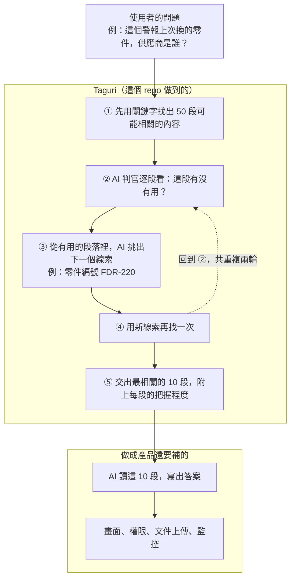
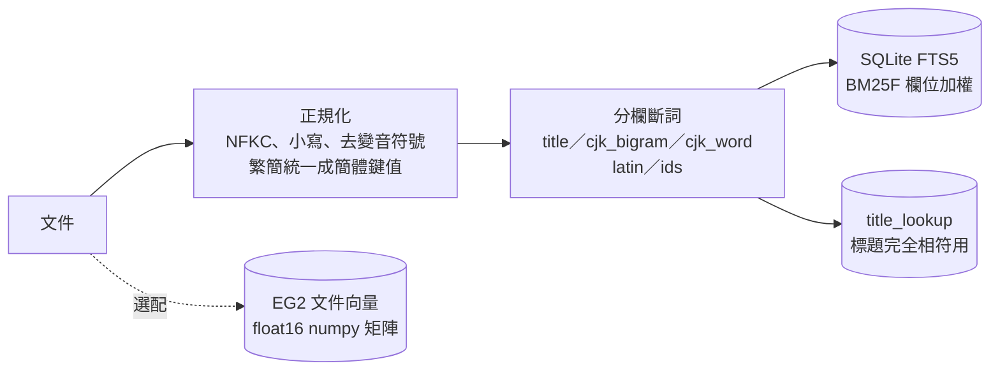
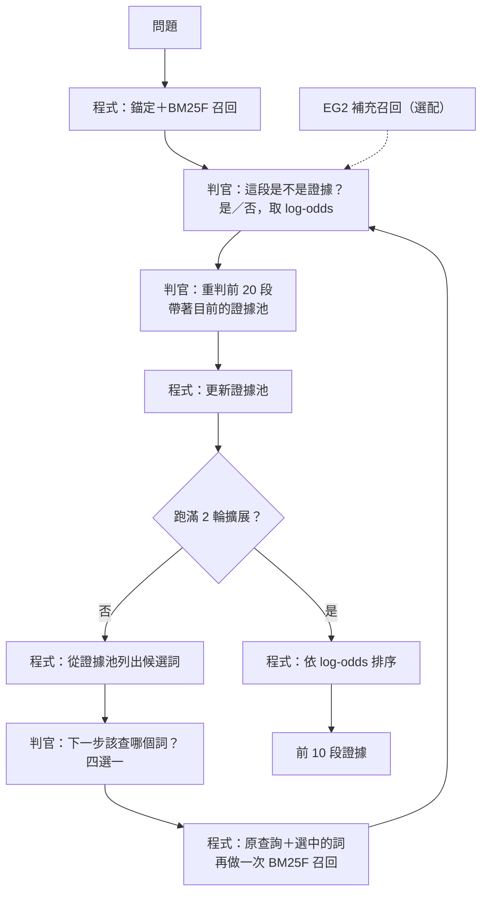

# Taguri

詞彙召回加上 jevlike 判官的多跳證據檢索。名字取自日文「手繰り」（把線一節一節拉回來）：每一輪由判官挑出下一個要追的詞，再去把相關的段落拉回來。

這個 repo 是 Taguri 的概念驗證（POC），裡面有實作和評測工具，也有各階段的實驗結果。所有實驗都用公開題組，在 Modal 的 L40S 上跑，沒有任何公司資料。

- 實驗計畫與每一段的門檻、結果：[`TAGURI-handoff.md`](TAGURI-handoff.md)（全案總結論在 §11.2）
- 各段報告：[`results/`](results/)
- 每一個設計決定與理由：[`docs/design-decisions.md`](docs/design-decisions.md)
- 還沒做、還沒驗證的事：[`TODO.md`](TODO.md)
- 一頁式的報告（給沒有參與的人看，講問題、做法、失手與結果）：[`docs/report/taguri.html`](docs/report/taguri.html)，用 [`docs/report/build.py`](docs/report/build.py) 產生
- 給接手開發的 agent 讀的說明（規則、限制、要做成產品還缺什麼）：[`llms.txt`](llms.txt)
- 在 GB10（不連外網）上接手重現與試用：[`docs/gb10-handoff.md`](docs/gb10-handoff.md)
- RAG 抽測（接上生成之後答得對不對）：[`results/rag-spotcheck.md`](results/rag-spotcheck.md)

## 一句話結論

Taguri 不用商用判官、不用向量資料庫，在英文多跳題上和上游的 SAG2＋Jev 打平（MuSiQue test R@5 80.20 對 80.99），每題約 143 次判斷，每千題約 1 美元。51 萬份企業文件上，加了 EG2 補撈之後也打平（80.71 對 81.10），不加時低 6.6 分。154 萬段的關鍵字檢索單獨一題約 4 秒。還落後的有兩塊：要把同一件事的文件找齊的題目低 13 到 31 分，中文比英文低約 13 分。**英文多跳檢索可以進產品化評估。進 PRD 之前還缺 GB10 上的單題延遲和自己文件上的驗證。**

## 現況總表

2026-11-11 的狀態。細節在後面各節和 [`results/`](results/)。

### 最終的分數

同一批題號逐題配對。R@k 是前 k 段找到的證據比例，AE@10 是前 10 段把證據全部找齊的題目比例。企業文件以文件為單位計分。

| 題組 | 指標 | 只用關鍵字 | B0 | SAG2＋Jev | Taguri | Taguri＋EG2 |
|---|---|---:|---:|---:|---:|---:|
| MuSiQue test 700 題（沒碰過） | R@5 | 48.93 | 沒跑 | 80.99 | **80.20** | 沒跑 |
| | AE@10 | 18.71 | 沒跑 | 69.86 | **71.86** | 沒跑 |
| MuSiQue dev 300 題 | R@5 | 44.69 | 77.47 | 79.94 | 80.17 | 80.94 |
| 2Wiki dev 100 題 | R@5 | 66.50 | 97.25 | 97.75 | 100.00 | 99.50 |
| MultiHop-RAG 300 題（新聞） | R@10 | 52.42 | 70.89 | 沒有紀錄 | 72.17 | 沒跑 |
| EnterpriseRAG 470 題（51 萬份文件） | R@10 | 67.82 | 只跑 60 題 | 81.10 | 74.50 | **80.71** |
| 　其中專案相關 40 題 | R@10 | 61.09 | 73.59 | 83.58 | 67.92 | 70.53 |
| 　其中完整性 20 題 | R@10 | 54.14 | 59.64 | 76.24 | 49.84 | 45.71 |
| 繁中 100 題（機器翻譯） | R@5 | 38.42 | 69.50 | 沒有 | 66.33 | 66.42 |
| 簡中 100 題（機器翻譯） | R@5 | 38.92 | 66.25 | 沒有 | 67.58 | 71.58 |
| 中文問、英文文件 100 題 | R@5 | | | | 16.58 | **65.42** |

- 「只用關鍵字」是上游的 BM25。B0 是上游的迴圈配同一顆地端判官。SAG2＋Jev 是上游原版配商用判官。
- **和 SAG2＋Jev 的差**：MuSiQue test −0.79（−2.58，+0.98），EnterpriseRAG 加 EG2 −0.39（−3.69，+3.00）。兩個都分不出高低。
- **還落後的**：專案相關 −13.05（−20.57，−5.40），完整性 −30.52（−44.52，−16.62）。兩類都是要把同一件事的多份文件找齊。
- 接上回答的抽測（企業文件 100 題，同一顆模型自己評分）：只用關鍵字答對 47 題，Taguri 64 題，直接給標準文件 83 題。

工作量和成本：

| | Taguri | B0 |
|---|---:|---:|
| MuSiQue 每題判斷次數 | 143 | 334 |
| EnterpriseRAG 每題判斷次數（不加／加 EG2） | 164／192 | 335 |
| EnterpriseRAG 每題輸入 token（不加／加 EG2） | 56 萬／67 萬 | 225 萬 |
| MuSiQue 每千題的 GPU 成本（L40S 估算） | 約 $1.0 | 約 $3.7 |
| 154 萬段時單獨一題的關鍵字檢索 | 約 4 秒 | |
| 省一點的設定（`thresholds.lite.json`） | 判斷次數 −11%，token −17%，分數不變 | |

### 什麼時候要建 embedding

原本的設計是完全不用向量。現在的結論是看語料：**問題和文件的用詞常常對不上時要建，對得上時不用。**

| 語料與問題的樣子 | 加 EG2 的效果 | 要不要建 |
|---|---|---|
| 問題會直接講出人名、作品名、產品名、編號（維基百科那類多跳題） | R@5 +0.46（−0.88，+1.83） | **不用** |
| 企業文件，問法和文件用詞不同 | R@10 +9.60（+3.20，+16.00） | **要** |
| 企業文件，一般的查找 | R@10 +7.43（+4.00，+11.43） | **要** |
| 一個問題問兩件事，各在一份文件 | R@10 +11.67（+3.33，+21.67） | **要** |
| 51 萬份企業文件整體 | R@10 +6.22（+3.74，+8.75），從落後 6.6 分到打平 | **要** |
| 中文問、英文文件 | R@5 16.58 → 65.42 | **一定要** |
| 簡體中文 | R@5 +4.00（+0.50，+7.67） | 可以建 |
| 繁體中文（機器翻譯題組） | R@5 +0.08（−4.17，+4.08） | 看不出差別 |
| 要把同一件事的多份文件找齊 | 專案相關 +2.61，完整性 −4.12，區間都包含 0 | 沒有幫助 |

不確定的話，先不建，用 20 到 30 個知道答案在哪的問題試。如果有一批問題連關鍵字都撈不到該找的文件，而且原因是用詞不同，就建。做法和門檻在 [`docs/gb10-handoff.md`](docs/gb10-handoff.md) 的階段 5。

要付出的：

| | 數字 |
|---|---|
| 建向量（一次性，L40S） | 每秒約 550 段。1.2 萬段 21 秒，154 萬段 132 分鐘、約 $4.33 |
| 建向量（CPU） | 每秒約 14 段，只適合小語料 |
| 向量檔 | 每一百萬段約 1.5 GB，就是一個 `.npy` 檔 |
| 查詢時 | 每題多 3 次向量查詢（各約 0.1 秒），判斷次數多約 17% |
| 文件有增修 | 索引重建之後向量也要重建 |

沒有變的原則有兩條。不用向量資料庫，向量載進記憶體直接比對。EG2 只決定哪些段落進候選，分數不進排序，誰是證據仍然由判官決定。

### 還沒做的事

完整的清單和每一項怎麼算做完在 [`TODO.md`](TODO.md)。

**一定要先知道的（在 GB10 上做，不花雲端的錢，步驟在 [`docs/gb10-handoff.md`](docs/gb10-handoff.md)）**

1. **單獨一題要等多久。** 所有實驗都是 16 題一起跑，沒有量過單題延遲。這決定能不能互動使用。
2. **llama-server 這條路。** 程式只用模擬伺服器驗過，沒接過真的。
3. **量化權重上的品質。** 雲端用的是 FP8，GB10 用 GGUF。
4. **自己的文件。** 會議記錄只有間接的數字，工廠記錄完全沒有，真實的繁中文件也沒有。
5. **本機的 EG2 配真的判官。** 只用替身判官跑通。

**分數還能補的**

6. **要把同一件事的文件找齊的題目。** 落後 13 到 31 分，判官約占 12 分，流程約占 7 分。流程那一塊是該找的文件沒被撈進候選，EG2 補不了，要另外做一條「依專案或實體展開」的路線。這一項要先有校準題，EnterpriseRAG 不能拿來調。
7. **換更強的判官。** 中文共同掉的 7 到 10 分和上面那 12 分都在判官，換流程補不回來。還沒試。
8. **橋接詞的候選品質。** 有一成多的判斷，判官其實想回答「都不是」。企業文件上常選到大寫開頭的普通字。
9. **第一名放對的比例。** 企業文件加 EG2 後 R@1 仍比 SAG2＋Jev 低 3.26 分。

**成本還能降的**

10. **小模型先判。** 靠調參數只能白拿一成多。要大幅降成本得讓小模型先判，低信心才送大模型。
11. **更大的語料。** 154 萬段可用。上千萬段要換成有提前終止的檢索引擎。

**做成產品要補的**

12. **回答的品質要有獨立的評分者。** 現在只有一次同一顆模型自己評的抽測。
13. 服務介面、權限與稽核、索引的增量更新、PDF 和 Office 文件的匯入、自動化測試。
14. 花費和 Modal 帳單核對。全案估算約 $39，帳號曾經撞到花費上限。

## 給 PM 的白話版

**Taguri 是一個資產，不是產品。** 它是一個可以重複使用的「找資料」元件，加上一套證明它有效的實驗紀錄。它沒有畫面，也沒有帳號權限，不會自己回答問題。它還沒有在公司自己的資料上驗證過。

### 它在做什麼

一般的搜尋只找「字面上像」的段落。但很多問題的答案散在好幾份文件裡，要先讀到第一份，才知道下一步該找什麼。Taguri 讓 AI 當判官，一輪一輪把線索接起來：



### 可以拿來做什麼

- **當 RAG 系統裡負責「找資料」的那一塊。** 它交出證據段落，後面再接一個模型寫答案。
- **適合的問題**是答案要從兩三份文件接起來的那種。例如「負責某專案的人，後來回報的落後原因是什麼」。
- **適合的環境**：不能連外網、資料不能出去的地方。它只需要一台有 GPU 的機器、一個資料庫檔案和一顆開源模型，不呼叫任何外部服務。
- **語言**：英文最成熟。繁體、簡體中文可以用但比英文差。中文問、英文文件也查得到（要加一個選配元件）。

### 不適合拿來做什麼

- **「把所有相關的都列出來」**：例如列出某專案歷次會議的全部決議。這類它沒有比關鍵字搜尋好。
- **數字的判斷**：例如「溫度有沒有超標」。那要用程式算，不是用搜尋。
- **純表格的資料**：欄位式的記錄用資料庫查詢比較準。
- **上千萬段的大型資料庫**：150 萬段試過，關鍵字那一層每題約 4 秒。再大十倍沒有試過。

### 改進了什麼

和現有做法在同一批公開測試題上比較：

| | 只用關鍵字搜尋 | 上游做法配商用 AI 判官 | Taguri |
|---|---:|---:|---:|
| 每 10 題裡，把需要的資料全部找齊的題數 | 約 2 題 | 約 7 題 | 約 7 題 |
| 接上 AI 回答後，100 題答對幾題（抽測） | 47 題 | 沒有測 | 64 題 |
| 51 萬份企業文件，前 10 份找到該找的文件 | 68% | 81% | 81%（要加向量補撈，不加是 75%） |
| 每查 1,000 個問題的運算成本 | 幾乎為零 | 約 4.3 美元 | 約 1 美元 |
| 需要連到外部服務 | 不用 | 要 | 不用 |

- **找資料的能力和商用方案打平**，但不依賴外部服務，成本約四分之一。
- **AI 判斷的次數少了一半以上**（每題 143 次，原本的做法是 334 次），所以比較快、比較便宜。
- **比關鍵字搜尋多找到很多**：需要多份文件才能回答的問題，從 10 題找齊 2 題變成 7 題。

第一列是英文維基百科多跳題（MuSiQue 700 題，前 10 段涵蓋全部證據的比例：18.7%、69.9%、71.9%）。第二列是企業文件題組抽 100 題，由同一顆 AI 自己評分，只能當方向參考。

### 現在的狀態

| | |
|---|---|
| 已經證明的 | 在公開的英文測試題上有效，四個不同的題組結論一致。51 萬份企業文件上也和商用方案打平 |
| 還不知道的 | 在公司的機器上一個問題要等多久。在公司自己的文件（會議記錄、工廠記錄、繁體中文）上的效果 |
| 下一步 | 在不連外網的機器上重現、量等待時間、用自己的文件試用（[步驟](docs/gb10-handoff.md)） |
| 要變成產品 | 還要接回答、畫面、權限、文件上傳、監控（[清單](TODO.md)） |

## 目錄

0. [現況總表](#現況總表)：最終的分數、什麼時候要建 embedding、還沒做的事
0. [給 PM 的白話版](#給-pm-的白話版)
1. [它解決什麼問題](#1-它解決什麼問題)
2. [架構](#2-架構)
3. [查詢流程](#3-查詢流程)
4. [和其他方式的比較](#4-和其他方式的比較)
5. [成本與查詢時間](#5-成本與查詢時間)
6. [能不能產品化](#6-能不能產品化)
7. [怎麼用](#7-怎麼用)
8. [Repo 結構](#8-repo-結構)
9. [已知限制](#9-已知限制)

## 1. 它解決什麼問題

多跳問題要靠好幾段文字接起來才答得出來，例如「Erik Hort 的出生地屬於哪個郡？」：

- 第一段說 Erik Hort 生於 Montebello。
- 第二段說 Montebello 在 Rockland County。

第二段和問題幾乎沒有共同的詞，單純用關鍵字或向量去查，查不到。要先讀到第一段，知道下一步該查「Montebello」，才找得到第二段。Taguri 做的就是這件事。**它先檢索，再判斷哪些段落有用，然後決定下一步查什麼，這樣重複幾輪。**

輸出是排好順序的證據段落（前 10 段），不是答案。它只負責檢索這一段。

## 2. 架構

**建索引**（只用 CPU，不呼叫任何模型）



- `cjk_word` 用 jieba。`latin` 用 Snowball 詞幹。`ids` 是編號，整段保留不切開。
- EG2 向量用暴力內積比對，沒有向量資料庫。

**查詢**



- 判官是 jevlike：Gemma 4 26B-A4B，讀第一個 token 的選項字母機率，不生成文字。
- 判官只做兩種題：「這段是不是證據」和「下一步該查哪個詞」。其餘都是程式做的。

兩條設計原則：

1. **判官做決定，程式準備候選、做計算。** 判官從不自己找東西，只在程式列好的選項裡選。
2. **建索引時不呼叫任何模型。** 唯一的例外是選配的 EG2 文件向量。

### 元件

| 元件 | 檔案 | 說明 |
|---|---|---|
| 正規化與斷詞 | [`taguri/analyze.py`](taguri/analyze.py) | 鍵值只用來比對。每個 token 都記得它在原文的位置，給判官看的、輸出的都是原文 |
| 詞彙索引 | [`taguri/index.py`](taguri/index.py) | SQLite FTS5、欄位加權 BM25、標題查表、詞組文件頻率 |
| 判官 | [`taguri/decide.py`](taguri/decide.py) | prompt、SGLang 呼叫、跨次執行的判斷結果快取 |
| 流程 | [`taguri/pipeline.py`](taguri/pipeline.py) | 下面第 3 節的每一步 |
| EG2 補充召回 | [`taguri/dense.py`](taguri/dense.py)、[`taguri/dense_server.py`](taguri/dense_server.py) | 選配。分數只決定哪些段落進候選，不進排序 |
| 執行入口 | [`taguri/run.py`](taguri/run.py)、[`modal_taguri.py`](modal_taguri.py) | 本機（CPU）與 Modal（GPU） |
| 評測 | [`evalkit/`](evalkit/) | R@k、AE@k、配對 bootstrap |

### 判官怎麼問

判官是 [jevlike](https://github.com/clarencechien/jevlike) 的讀法：把問題寫成選擇題，讀模型回答第一個 token 時各選項字母的機率。不生成文字，所以一次判斷只要一次前向計算。

- 判證據的分數用 **log-odds**（log P(是) − log P(否)），不用機率。機率太兩極，大量同分。
- 每題一段、選項不超過 4 個、只用肯定問句、選項順序固定。
- 英文題目的問法（校準半上從 7 種裡選的）：`Does the candidate passage help with the user question? A passage helps if it gives the answer, or if it identifies a person, place, work or thing that the user question describes indirectly.`

## 3. 查詢流程

定案的設定叫 **N1**。每題固定跑 1 輪初始檢索加 2 輪擴展。

| 步驟 | 誰做 | 內容 |
|---|---|---|
| 1. 錨定 | 程式 | 問題裡和某個段落標題、某個編號**完全相符**的字串，對應的段落直接列入候選，而且排最前面判 |
| 2. 召回 | 程式 | BM25F 取前 50 段。擴展輪用「原查詢分數 ＋ 2 × 選中詞的分數」 |
| 2b. 補充召回（選配） | 程式 | EG2 用當輪的查詢取前 20 段，扣掉已經有的，排在候選最後面 |
| 3. 判證據 | 判官 | 新段落每 5 段一批。prompt 帶著「目前已有的證據」，批與批之間更新 |
| 4. 重判 | 判官 | log-odds 最高的 20 段裡，如果當初判斷時的證據池和現在不同，帶著現在的證據池再判一次 |
| 5. 證據池 | 程式 | log-odds ≥ −6 的取前 8 段。不足 2 段時，用 log-odds 最高的 2 段當**暫定證據** |
| 6. 選橋接詞 | 程式準備，判官選 | 從證據池抽候選詞（標題、編號、大寫詞組，中文用專有名詞），去掉查了不會有新段落的，依 IDF 取前 8 個分兩組，判官每組選 1 個 |
| 7. 下一輪 | 程式 | 新查詢 ＝ 原查詢 ＋ 選中的 2 個詞，回到步驟 2。判過的段落不進新候選 |
| 8. 輸出 | 程式 | 最後再重判一次。所有判過的段落依 log-odds 排序，不足 10 段用 BM25F 補 |

三個對分數影響最大的設計（校準半 150 題的 R@5）：

| 設計 | 效果 | 為什麼 |
|---|---:|---|
| 每輪重判前 20 段 | 64.3 → 74.9 | 金標有三分之二在第一輪就被撈到，當時沒有上下文。第二跳的段落要等第一跳找到之後才判得出來 |
| 暫定證據 2 段 | 74.9 → 78.7 | 第一跳的段落常在沒有上下文時被判否，證據池是空的話整題沒有東西可以接 |
| 判官選橋接詞（對照：直接取 IDF 最高的 2 個） | dev 400 題 +2.23 | 程式列的候選裡有很多沒用的稀有詞，要靠判官讀過證據後挑 |

試過但沒有採用：判官判斷「證據夠了就提早停」（變差 4.6 分）、選詞加「都不適合」選項、多跑一輪、題型路由（題組太簡單，量不出來）。細節在 [`results/s6-taguri.md`](results/s6-taguri.md)。

## 4. 和其他方式的比較

所有比較都在同一批題號上逐題配對。括號是配對 bootstrap 的 95% 信賴區間。指標：

- **R@k**：前 k 段撈到的金標證據占全部金標的比例。
- **AE@k**：前 k 段涵蓋全部金標的題目比例。

比較對象：

| 名稱 | 是什麼 |
|---|---|
| BM25 | 上游的純關鍵字檢索 |
| N0 | Taguri 只開詞彙層（不呼叫判官） |
| SAG2＋Jina | 上游的 SAG2 迴圈，判官用 Jina v3.5 reranker |
| B0 | 上游的 SAG2 迴圈，判官換成 jevlike（Session A 建的基線） |
| SAG2＋Jev | 上游的原版（商用判官 Jev），上游作者跑好的逐題紀錄 |

### 4.1 英文多跳題

| 題組 | 指標 | BM25 | SAG2＋Jina | B0 | SAG2＋Jev | **Taguri** |
|---|---|---:|---:|---:|---:|---:|
| MuSiQue test 700 題 | R@5 | 48.93 | 66.23 | 沒跑 | 80.99 | **80.20** |
| | AE@10 | 18.71 | 44.14 | 沒跑 | 69.86 | **71.86** |
| MuSiQue dev 300 題 | R@5 | 44.69 | 64.17 | 77.47 | 79.94 | **80.17** |
| 2Wiki dev 100 題 | R@5 | 66.50 | 83.50 | 97.25 | 97.75 | **100.00** |
| MultiHop-RAG 300 題（新聞） | R@10 | 52.42 | | 70.89 | 沒有紀錄 | **72.17** |

- 對 SAG2＋Jev（MuSiQue test）：ΔR@5 −0.79（−2.58，+0.98），**分不出高低**。
- 對 B0（dev 400 題）：ΔR@5 +2.71（+0.54，+4.85）。MultiHop-RAG 上 ΔR@10 +1.28（−1.42，+3.86），持平。
- 對 BM25：高 20 到 35 分。
- test 只跑一次、沒有調過。dev 80.17 和 test 80.20 幾乎相同，沒有過擬合。MultiHop-RAG 完全沒拿來調參數。

依跳數（MuSiQue test，R@5）：

| | 題數 | Taguri | SAG2＋Jev | BM25 |
|---|---:|---:|---:|---:|
| 2 跳 | 357 | 89.08 | 90.34 | 56.72 |
| 3 跳 | 229 | 77.15 | 77.58 | 45.85 |
| 4 跳 | 114 | 58.55 | 58.55 | 30.70 |

### 4.2 企業文件（EnterpriseRAG-Bench，51 萬份文件、154 萬段）

文件層級的 R@10。向量檢索那一欄是題組論文的數字，只能當參照。SAG2＋Jev 那一欄是上游留下的逐題紀錄，題號和文件編號與我們的一致，可以配對（[`results/attribution.md`](results/attribution.md)）。

| 題型 | 題數 | N0 | Taguri | Taguri＋EG2 | 參考：向量檢索 | SAG2＋Jev |
|---|---:|---:|---:|---:|---:|---:|
| 基本檢索 | 175 | 77.14 | 83.43 | **90.86** | 48.6 | 86.86 |
| 語意檢索 | 125 | 42.40 | 52.80 | **62.40** | 24.8 | 58.40 |
| 文件內推理 | 40 | 95.00 | 95.00 | 97.50 | 57.5 | 100.00 |
| 專案相關 | 40 | 64.24 | 67.92 | 70.53 | 49.2 | 83.58 |
| 限定條件 | 30 | 86.67 | 85.00 | **96.67** | 83.3 | 96.67 |
| 資訊衝突 | 20 | 92.50 | 87.50 | 90.00 | 55.0 | 92.50 |
| 完整性 | 20 | 50.12 | 49.84 | 45.71 | 33.4 | 76.24 |
| 其他 | 20 | 90.00 | 100.00 | 95.00 | 75.0 | 100.00 |
| **整體** | 470 | 68.98 | 74.50 | **80.71** | 46.0 | 81.10 |

- Taguri 比詞彙層高 5.51 分（+2.73，+8.39）。不加 EG2 時整體比 SAG2＋Jev 低 6.60 分（−9.98，−3.16）。
- **加了 EG2 之後整體追平**：80.71 對 81.10，差 **−0.39（−3.69，+3.00）**。比不加時高 6.22 分（+3.74，+8.75）。其餘 170 題是後來補跑的（[`results/attribution-followup.md`](results/attribution-followup.md)）。
- **追平的組成不一樣。** 基本檢索和語意檢索各高 4 分，限定條件相同（96.67），專案相關低 13.05 分，完整性低 30.52 分。
- **不加 EG2 時弱點有三類**。專案相關 −15.66（−24.31，−7.36），完整性 −26.40（−40.47，−12.58），限定條件 −11.67（−21.67，−3.33）。限定條件的失分來自兩段式的問題只找到一份文件，加 EG2 就補回來了。前兩類要把同一件事的多份文件找齊，EG2 沒有幫助。
- **專案相關加完整性落後的 19 分怎麼分**：Session A 讓 B0 跑了這 60 題。只換判官（B0 − SAG2＋Jev）是 −12.19（−18.63，−6.01），只換迴圈（Taguri − B0）是 −7.05（−13.70，−0.60）。判官約 12 分，迴圈約 7 分。
- **EG2 在這裡有用**：語意檢索 +9.60（+3.20，+16.00），基本檢索 +7.43（+4.00，+11.43），限定條件 +11.67（+3.33，+21.67）。

### 4.3 中文與跨語言

同一批 100 題（MuSiQue 用 Gemma 翻成繁中、再轉簡中），R@5：

| | 英文 | 繁中 | 簡中 |
|---|---:|---:|---:|
| 上游 BM25 | 41.67 | 38.42 | 38.92 |
| 只有詞彙層 | 46.08 | 38.58 | 38.58 |
| B0（上游迴圈配同一顆判官，沒有為中文調過） | 76.42 | 69.50 | 66.25 |
| Taguri | 80.25 | 66.33 | 67.58 |
| Taguri＋EG2 | 81.58 | 66.42 | 71.58 |
| **跨語言：中文問、英文文件，Taguri＋EG2** | | 65.42 | 65.08 |
| 跨語言，不含 EG2 | | 16.58 | |

- 中文比英文低約 13 分（繁中 −13.92，區間 −19.33 到 −8.33）。只看 Taguri 自己，詞彙層占 7.5 分，判官迴圈占約 6 分。
- **這 13 分大半不是 Taguri 造成的。** B0 在同一份資料上也掉 6.92 分（繁中）到 10.17 分（簡中）。同語言直接比，Taguri − B0 是繁中 −3.17（−8.08，+1.67）、簡中 +1.33（−3.67，+6.50），分不出高低。共同掉的那一塊在判官，它在中文上變保守，和提示詞用哪種語言無關。
- **Taguri 在繁中多掉約 7 分，勉強成立**（區間 −13.67 到 −0.33，簡中不支持）。其中約 4 分在詞彙層：詞彙層在英文上比上游 BM25 高 4.42 分，這一截到中文就沒有了。
- 繁簡之間沒有差別（不含 EG2 時差 1.25 分）。加 EG2 之後簡體比繁體高 5 分。
- **跨語言加了 EG2 就能用，不必翻譯文件**：第一輪靠 EG2 找到英文段落，之後的橋接詞是從英文證據裡抽的英文詞，詞彙檢索就回到英文查英文。
- 沒有 SAG2＋Jev 在中文上的數字。
- 這份中文資料是機器翻譯的，有已知的翻譯缺陷（[`results/s7b-dev-zh.md`](results/s7b-dev-zh.md)）。數字只能當方向參考。

### 4.4 EG2（EmbeddingGemma 2）要不要加

EG2 是唯一用到的 embedding，只當補充召回。什麼時候要建、要付出多少，整理在最前面的[現況總表](#什麼時候要建-embedding)。這裡是各場景的數字。

| 場景 | 增益 | 建議 |
|---|---|---|
| 英文多跳（實體型題目） | R@5 +0.46（−0.88，+1.83） | 不用加 |
| 企業文件：問法和文件用詞不同 | R@10 +9.60（+3.20，+16.00） | 加 |
| 企業文件：基本檢索 | R@10 +7.43（+4.00，+11.43） | 加 |
| 企業文件：兩段式的問題（限定條件） | R@10 +11.67（+3.33，+21.67） | 加 |
| 企業文件：找齊同一件事的多份文件 | 專案相關 +2.61（−3.47，+8.83），完整性 −4.12（−11.71，+2.79） | 沒有幫助 |
| 企業文件：全部 470 題 | R@10 +6.22（+3.74，+8.75），加了之後和 SAG2＋Jev 分不出高低 | 加 |
| 簡中多跳 | R@5 +4.00（+0.50，+7.67） | 可以加 |
| 繁中多跳 | R@5 +0.08（−4.17，+4.08） | 沒有幫助 |
| 中文問、英文文件 | R@5 16.58 → 65.42 | 一定要加 |

### 4.5 和上游做法的差異

Taguri 是獨立實作的（clean-room：沒有讀過 SAG2 的程式碼、論文和文件，紀錄在 [`docs/clean-room-log.md`](docs/clean-room-log.md)），所以這裡只列 Taguri 自己的設計和它有沒有數字支持：

| 設計 | 有沒有數字支持 |
|---|---|
| 判官選下一輪要查的橋接詞 | 有：比直接取 IDF 最高的詞高 2.23 分（+0.69，+3.75） |
| 每題約 143 次判斷（B0 是 334 次） | 有：分數不輸 B0 |
| 只重判前 20 名，而且只在證據池變了的時候重判 | 有：校準半 +10.7 分 |
| 暫定證據 | 有：校準半 +2 到 +4 分 |
| 五欄位 BM25F ＋ 標題／編號錨定 | 有：N0 比上游 BM25 高 2.46 分（+0.92，+4.00） |
| 繁簡正規化、bigram 與詞典斷詞並用 | 部分：DRCD 單跳題上比不正規化高 1.7 分 |
| 題型路由 | 沒有：題組太簡單，量不出來 |

最初的規格寫的是「判過的段落不重判」，照做的結果比 B0 低 11.88 分，所以這一條放寬了。「完全不重判」不是 Taguri 的特點。

## 5. 成本與查詢時間

### 5.1 每題的成本

Modal L40S 以每小時 1.95 美元估算。數字是容器時間乘單價，**沒有和帳單核對**。

| 題組 | 每題判斷次數（中位數／第 90 百分位） | 每題輸入 token | 每題 GPU 時間（16 題並行的吞吐量） | 每千題 |
|---|---:|---:|---:|---:|
| MuSiQue（段落約 400 字元） | 143／170 | 9.2 萬 | 1.8 秒 | **約 $1.0** |
| MultiHop-RAG（段落約 1,000 字元） | 139／158 | 23.5 萬 | 4.4 秒 | 約 $2.4 |
| EnterpriseRAG（段落約 2,000 字元） | 168／195 | 56 萬 | 見 5.3 | 約 $10 |
| EnterpriseRAG ＋ EG2 | 203／231 | 69 萬 | 見 5.3 | 約 $9 到 $10 |

對照：上游紀錄的 Jev 每千題約 $4.33。B0（同一顆模型、SAG2 迴圈）每千題約 $3.7。

成本大致和「判斷次數 × 段落長度」成正比。伺服器的前綴快取命中約 67%（同一輪的候選共用「問題＋已有證據」這段前綴）。

### 5.2 一次性的成本

| 項目 | MuSiQue（1.2 萬段） | EnterpriseRAG（154 萬段） |
|---|---:|---:|
| 建詞彙索引（CPU） | 5 秒 | 5 分鐘（14 個行程） |
| 索引檔大小 | 18 MB | 7.7 GB |
| 建 EG2 向量（選配，L40S） | 21 秒 | 132 分鐘 GPU 時間，約 $4.33 |
| EG2 向量檔 | 18 MB | 2.4 GB |

### 5.3 查詢時間

**還沒有量過「單獨一題要等多久」。** 所有實驗都是 16 題並行，量到的是吞吐量和並行時每題的經過時間：

| 題組 | 16 題並行時每題經過時間（中位數／第 90 百分位） | 換算吞吐量 | 時間花在哪 |
|---|---:|---:|---|
| MuSiQue | 29 秒／36 秒 | 每 1.8 秒完成一題 | 幾乎都在等判官（GPU） |
| MultiHop-RAG | 72 秒／87 秒 | 每 4.4 秒一題 | 判官 |
| EnterpriseRAG（S10 當時） | 309 秒／435 秒 | 每 19 秒一題 | 大部分在關鍵字檢索（CPU）。判官等待的中位數只有 21 秒 |
| EnterpriseRAG（檢索加速之後，判斷用快取） | 4.7 秒／7.0 秒 | 每 0.3 秒一題 | 只剩檢索。判官的時間要另外加 |

兩個要注意的地方：

1. **單題延遲會比並行時每題的經過時間短，但不會短到吞吐量那個數字。** 每題約 143 次判斷分成 30 多個批次依序送出（每 5 段一批，批與批之間要更新證據），這些批次不能平行。粗估單獨一題在 L40S 上是數秒到十幾秒，這個數字要實測。
2. **154 萬段時，關鍵字檢索原本是瓶頸，現在不是了。** S10 當時每題要 5 分鐘，其中單獨一題的檢索就要 43 秒。原因是一種查詢的寫法讓 SQLite 一筆一筆重算。改掉之後單獨一題的檢索約 4 秒，輸出逐題相同（[`results/b1-b4-b7.md`](results/b1-b4-b7.md)）。剩下的 2 到 3 秒是替所有符合的段落計分一次，要再降得換檢索引擎。

另外，Modal 上的速度不等於地端機器（GB10）上的速度。

### 5.4 這個 POC 總共花了多少

約 29.5 美元（上限 60），明細在 [`results/cost.md`](results/cost.md)。Session A 之後的歸因補測另外約 3.6 美元，之後補跑 EG2 約 1.5 美元，再之後的檢索加速與降配測試約 4.2 美元，全案約 39 美元。

## 6. 能不能產品化

### 現在可以說的

| 項目 | 狀態 | 依據 |
|---|---|---|
| 英文多跳檢索的品質 | **達標** | test 700 題和 SAG2＋Jev 打平。沒看過的新聞題組不輸 B0 |
| 不依賴外部服務 | **達標** | 判官是地端的 Gemma 4 26B。不呼叫 Jev。不需要向量資料庫 |
| 成本 | **達標** | 每千題約 $1，是 B0 的四分之一。另有省 11% 判斷次數的設定，分數不變 |
| 大語料的檢索速度 | **達標** | 154 萬段單獨一題的關鍵字檢索約 4 秒，輸出和加速前逐題相同 |
| 繁、簡、英共用一條流程 | 可用但有落差 | 繁簡沒有差別。中文比英文低約 13 分，B0 也掉 7 到 10 分 |
| 跨語言（中文問英文文件） | 可用（要加 EG2） | 和先把文件翻成中文一樣好 |
| 企業文件規模的品質 | 加 EG2 後追平 | 整體 R@10 74.5，比 SAG2＋Jev 低 6.6 分。加 EG2 後 80.7，和 SAG2＋Jev 的 81.1 分不出高低。找齊多份文件的題型仍然落後 |

### 進 PRD 之前還缺的

依重要性排：

1. **GB10 上的單題延遲。** 這是最大的未知數。每題 143 次判斷、9 萬 token（長段落是 168 次、56 萬 token），在 GB10 上可能是幾十秒。交接文件 §13 把它列為第一項，不花雲端的錢。
2. **大規模語料的詞彙檢索速度。**（2026-11-11 已處理）154 萬段時單獨一題的檢索從 43 秒降到約 4 秒。同時跑很多題時要加 `--lex-procs`。再往下要換成有提前終止的檢索引擎，目前不是最急的事。
3. **真實的繁中資料。** 現在的中文數字來自機器翻譯的題組，有翻譯缺陷，也沒有任何製造業的文件。判官對中文金標判「是」的比例是 52%（英文 65%），換題目寫法沒有改善。B0 用英文提示詞也有同樣幅度的落差，所以在這份翻譯題組上繼續調的報酬很低。
4. **只量了檢索召回率，沒有量答案品質。** 後面還要接生成，端到端的正確率沒有測。
5. **選橋接詞那一題的讀法不健康。** 有 11% 到 15% 的判斷，選項字母加起來的機率低於 0.5，模型其實想回答「都不是」。加「都不適合」選項反而掉分，目前是從不好的候選裡硬選一個。
6. **「找齊多份文件」的題型落後**（EnterpriseRAG 的專案相關、完整性，加了 EG2 仍然低 13 到 31 分）。落差裡判官約 12 分、迴圈約 7 分。迴圈那一塊是候選沒撈到，EG2 補不了。
7. **企業文件要追平得開 EG2。** 本機入口已經可以開（`--dense-vectors`），但還沒有在本機接真的判官跑過。

### 建議

- **可以進 PRD 的範圍**：英文的多跳證據檢索，以及英文企業文件的檢索（要開 EG2）。把它當成「取代商用判官與 reranker 的地端方案」來規劃，前提是先在 GB10 上確認延遲可以接受。
- **還不該承諾的**有四件：單題的等待時間，繁中的品質，「把同一件事的文件找齊」這類問題，以及端到端的回答正確率。
- **下一步的順序**：GB10 量 20 題延遲 → 用自己的文件試用（會議記錄先，含 EG2）→ 接生成做端到端評測 → 再決定要不要做「找齊多份文件」的路線或換判官。完整的清單在最前面的[現況總表](#還沒做的事)。

## 7. 怎麼用

### 7.1 安裝

```bash
python -m venv .venv && . .venv/bin/activate
pip install -e .                       # evalkit（只依賴 numpy）
pip install jieba==0.42.1 opencc-python-reimplemented==0.1.7 snowballstemmer==3.1.1 tokenizers requests
pip install 'modal[api-proxy-support]' # 要在 Modal 上跑判官時才需要
pip install torch torchvision pillow 'sentence-transformers>=6.1.0' 'transformers>=5.19.0'   # 要開 EG2 時才需要
```

### 7.2 資料格式

每個題組一個資料夾 `data/<題組>/`：

```
corpus.jsonl     每行 {"pid", "title", "text"}             （以文件計分時另加 "doc"）
questions.jsonl  每行 {"qid", "question", "gold_pids", "type"}
splits.json      {"<切分名稱>": [qid, ...]}
```

repo 裡附了 `musique`、`2wikimultihopqa`、`multihop-rag` 三個題組。

### 7.3 只跑詞彙層（本機 CPU，不需要 GPU）

```bash
python -m taguri.run --config N0 --dataset musique --split dev
```

第一次會在 `/tmp/taguri-idx/` 建索引（MuSiQue 約 5 秒）。結果寫到 `--out` 指定的資料夾：

- `run.jsonl`：每題的前 10 段
- `trace.jsonl.gz`：每題的完整紀錄（每次判斷的原始 log-prob、每輪的證據池、選了哪些詞、判斷次數與 token 數）
- `summary.json`

### 7.4 跑完整流程（需要判官）

判官是 SGLang 上的 Gemma 4 26B-A4B FP8。Modal 的入口會在同一個容器裡啟動 SGLang 和流程：

```bash
export MODAL_TOKEN_ID=... MODAL_TOKEN_SECRET=...

modal run --detach modal_taguri.py::main --stage demo \
  --jobs '[{"config":"N1","dataset":"musique","split":"dev"}]'

modal volume get taguri-b-results /demo out/     # 取回結果
```

`--jobs` 是 JSON 陣列，一次可以排很多組，會在同一個容器裡依序跑（省冷啟動）。常用欄位：

| 欄位 | 說明 |
|---|---|
| `config` | `N0`（只有詞彙層）、`N1`（定案）、`N1c`（不問判官選詞）、`N2`（判官決定何時停）、`N3`（題型路由）。加 `+EG2` 開補充召回 |
| `dataset`、`split` | 題組與切分 |
| `lang` | `en` 或 `zh`（決定 prompt 的語言，中文語料會自動套用中文的候選詞設定） |
| `data_root` | 題組不在 image 裡時，指到 Volume 上的路徑 |
| `doc_field`、`doc_level` | 以文件為單位計分時用（EnterpriseRAG） |
| `limit`、`types` | 只跑前幾題、只跑某些題型 |
| `tag` | 輸出資料夾名稱 |

要用 EG2 時加 `--eg`（會用另一個 image，並把 EG2 放在同一張 GPU 上）：

```bash
modal run --detach modal_taguri.py::main --eg --stage demo \
  --jobs '[{"config":"N1+EG2","dataset":"musique","split":"dev"}]'
```

單題查詢（不需要金標，`--judge none` 只用詞彙層）：

```bash
python tools/ingest_files.py --src /path/to/docs --out store --name mydocs     # 文字檔 → corpus.jsonl ＋ SQLite 索引
python -m taguri.query --db store/idx/mydocs.db --doc-level --question "……" \
  --judge llama --base-url http://127.0.0.1:8080
```

判官也可以用 llama-server（`--judge llama`，GB10 上的預設路徑，這個後端只用模擬伺服器驗過流程，還沒接過真的 llama-server，見 [`docs/gb10-handoff.md`](docs/gb10-handoff.md)）。

已經有自己的 SGLang 伺服器時，可以不經過 Modal：

```bash
python -m taguri.run --config N1 --dataset musique --split dev --judge sglang \
  --base-url http://127.0.0.1:30000 --tokenizer /path/to/model/tokenizer.json
```

伺服器要求：Gemma 4 26B-A4B，context 至少 16,384，不開 MTP 草稿頭（會讓第一個 token 的機率不穩定）。SGLang 的啟動參數見 `modal_taguri.py` 的 `start_server`。

本機也可以開 EG2。先替索引建一次向量，之後查詢時帶上向量檔：

```bash
# 建向量（一段一列，float16）。--model 可以是本機的模型資料夾，不連外網也能用
python -m taguri.dense build --db store/idx/mydocs.db --out store/idx/mydocs.eg2.npy \
  --model /models/embeddinggemma-2 --device cuda

# 單題查詢：給了 --dense-vectors 就會開 EG2
python -m taguri.query --db store/idx/mydocs.db --doc-level --question "……" \
  --judge llama --base-url http://127.0.0.1:8080 \
  --dense-vectors store/idx/mydocs.eg2.npy --eg2-model /models/embeddinggemma-2 --eg2-device cpu

# 整批評測
python -m taguri.run --config N1+EG2 --dataset musique --split dev --judge llama --base-url http://127.0.0.1:8080 \
  --dense-vectors /tmp/taguri-idx/musique.eg2.npy --eg2-model /models/embeddinggemma-2
```

- `--eg2-device cpu` 時，查詢的向量在 CPU 上算（每次約 0.07 秒），GPU 留給判官。建向量建議用 GPU：CPU 上每秒只有十幾段。
- 向量檔的列數和索引的段落數不一樣時會直接報錯，避免拿錯檔。
- EG2 要放在另一個 Python 環境時，起 `taguri/dense_server.py`，再用 `--eg2-url http://127.0.0.1:30100`。
- 本機這條路驗過的範圍見 [`results/b1-b4-b7.md`](results/b1-b4-b7.md) 第 2 節。沒有在本機接真的判官跑過。

### 7.5 計分與比較

```bash
# 計分
python -m evalkit score --dataset musique --split dev --run out/run.jsonl --out my_scores.jsonl

# 和參考方法做配對 bootstrap（印出 a − b 與 95% 信賴區間）
python -m evalkit compare --dataset musique --split dev \
  --a my_scores.jsonl --b reference/musique/b0.jsonl --metrics R@5 R@10 AE@10
```

`reference/` 裡有各參考方法的逐題分數（BM25、B0、SAG2＋Jev、SAG2＋Jina），說明在 [`reference/README.md`](reference/README.md)。

### 7.6 參數

所有調過的參數都鎖在 [`results/thresholds.lock.json`](results/thresholds.lock.json)，執行時自動讀取：

| 參數 | 值 | 意義 |
|---|---|---|
| `weights.title` | 4 | BM25F 的標題欄位權重（其餘欄位 1） |
| `tau` | −6 | 進證據池的 log-odds 門檻 |
| `chunk` | 5 | 判證據的批次大小 |
| `rejudge_each` | 20 | 每輪重判前幾名 |
| `min_pool` | 2 | 暫定證據的段數 |
| `q3_variant`、`layout` | I、L2 | 判證據的題目寫法 |
| `zh` 區塊 | | 只在中文語料套用：專有名詞候選、標題詞優先 |

這些都是在 MuSiQue 的校準半（150 題）上各調一次，在檢查半上確認沒有過擬合。沒有在 test、MultiHop-RAG、EnterpriseRAG 上調過。

另有一份省一點的設定 [`results/thresholds.lite.json`](results/thresholds.lite.json)：每輪重判 10 段、證據池最多 5 段。判斷次數少 11%，輸入 token 少 17%，校準半和檢查半的 R@5 都沒有可量測的差別。用 `--lock results/thresholds.lite.json` 套用。其他降配選項掉多少分見 [`results/b1-b4-b7.md`](results/b1-b4-b7.md) 第 3 節。

### 7.7 換成自己的語料

1. 把文件切成段落，寫成 `corpus.jsonl`。建議每段不超過 2,000 字元。標題欄位放文件標題（錨定和欄位加權都會用到）。
2. 把問題寫成 `questions.jsonl`。執行結束時會計分，所以每題要有 `gold_pids`。
3. 用 `--data-dir`（本機）或 `data_root`（Modal）指到資料夾。
4. 段落很長時，prompt 裡的「已有證據」會自動截到 10,000 token 以內。

## 8. Repo 結構

```
taguri/            檢索流程本體
evalkit/           指標與資料載入
modal_taguri.py    Modal 入口（判官執行、翻譯、EnterpriseRAG 準備、EG2 向量）
analysis/          各段報告用的比較腳本
tools/             題組轉檔、翻譯、EnterpriseRAG 分段
data/              三個公開題組（正規化後）
reference/         參考方法的逐題分數
results/           各段報告、花費紀錄、鎖定的參數
docs/              設計決策、先前技術、clean-room 紀錄
handoff/           Session A 交給 Session B 的說明（含之後的歸因補測）
TAGURI-handoff.md  實驗計畫與全案總結論
```

各段報告：

| 檔案 | 內容 |
|---|---|
| [`results/s6-taguri.md`](results/s6-taguri.md) | 逐步建構與元件取捨（做了兩次，第二次是定案） |
| [`results/s7a-zh-lexical.md`](results/s7a-zh-lexical.md) | 中文斷詞設定的比較（DRCD） |
| [`results/s7b-dev-zh.md`](results/s7b-dev-zh.md) | 中文測試題組的翻譯與抽查 |
| [`results/s7c-trilingual.md`](results/s7c-trilingual.md) | 第一次三語比較 |
| [`results/s7d-zh-followup.md`](results/s7d-zh-followup.md) | 跨語言測試、重翻問題、中文調整後的三語比較 |
| [`results/s8-test.md`](results/s8-test.md) | MuSiQue test 700 題 |
| [`results/s9-multihop-rag.md`](results/s9-multihop-rag.md) | MultiHop-RAG 外部驗證 |
| [`results/s10-enterprise.md`](results/s10-enterprise.md) | EnterpriseRAG-Bench 與 EG2 的最終判定 |
| [`results/rag-spotcheck.md`](results/rag-spotcheck.md) | 接上回答的 100 題抽測 |
| [`results/attribution.md`](results/attribution.md) | 歸因補測：中文與企業文件的落差算在判官還是迴圈 |
| [`results/attribution-followup.md`](results/attribution-followup.md) | 歸因之後的三件事：重算配對、兩個診斷、EG2 跑完全部題型 |
| [`results/b1-b4-b7.md`](results/b1-b4-b7.md) | 大語料檢索加速、EG2 本機整合、降配的分數 |
| [`results/cost.md`](results/cost.md) | 花費明細 |

## 9. 已知限制

- **只量檢索召回率**，沒有量答案品質。
- **所有題組都不是製造業的文件。** 這個 POC 回答的是「這套通用架構站不站得住」，不是「在工廠資料上好不好用」。
- **中文數字來自機器翻譯的題組**，段落的譯文有已知缺陷。100 題的標準誤約 ±4 分。
- **歸因的數字來自 Session A 的補測**，題數少（中文 100 題，企業文件 60 題），有兩個判定是壓線通過的。企業文件的部分 Session B 用逐題分數重算過，數字相同。中文的部分沒有重算。
- **單題延遲沒有量過**。大規模語料的檢索時間量過了（154 萬段單獨一題約 4 秒），判官的時間還沒有。
- **花費是估算**，沒有和 Modal 帳單核對。
- **分數會隨伺服器數值有小幅抖動**。各設定之間的比較用判斷結果快取固定住了，但重跑整個流程不保證逐題相同。
- **clean-room 是盡力而為**：實作時沒有接觸上游的程式碼與論文，但規格是在讀過上游公開文件之後寫的，不是法律等級的保證，也不處理專利問題。
